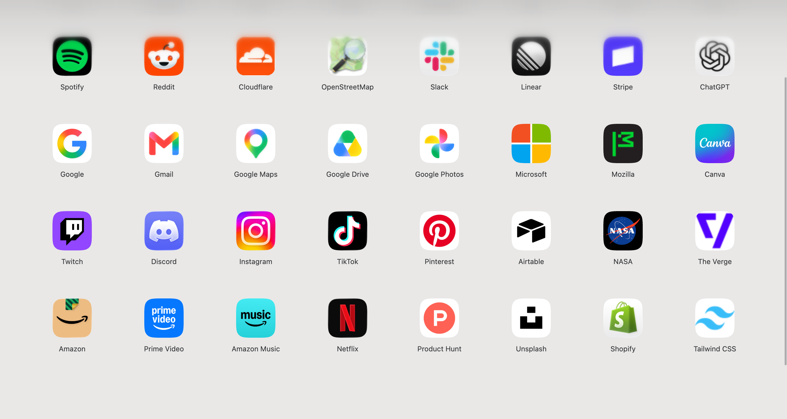
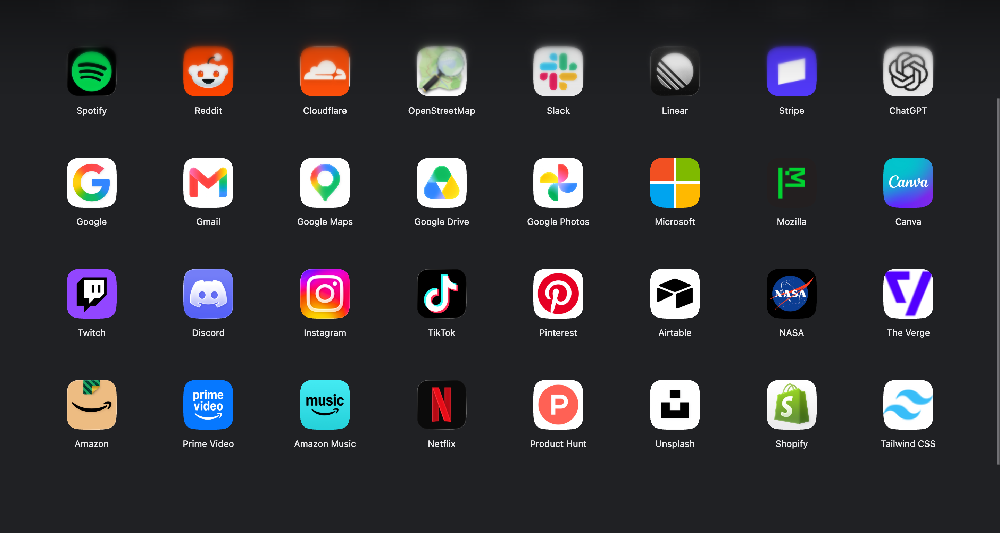

[中文](README.md) | [English](README.en.md)

# Yiu’s tab

A minimal Chrome new-tab extension with a responsive bookmark grid, high-resolution icons, drag sorting, appearance controls, and optional WebDAV sync.





## Features

- Responsive bookmark grid, automatic light/dark themes, shared UI components, and motion effects.
- Prefer website artwork with local caching; optionally use third-party sources, Apple App Store matches, or local images.
- Option-click or Alt-click a site icon to adjust its appearance. Option-click or Alt-click empty space to open extension settings. The first-run empty state shows the appropriate key and mouse guidance for the current platform.
- Import and export complete configuration, with optional WebDAV automatic sync for bookmarks, artwork, and appearance settings.
- Chinese, English, Japanese, and Korean interfaces; extension metadata also includes Traditional Chinese.

## Installation

Requires Chrome 139 or later (Manifest V3).

1. Download and extract the source or extension package.
2. Open `chrome://extensions` and enable Developer mode.
3. Choose **Load unpacked** and select the directory containing `manifest.json`.
4. Open a new tab and add websites to the “Other bookmarks → Yiu's tab” folder in the bookmark manager.

The folder can be moved or renamed, but keep the ID bookmark used for identification. To update a loaded extension, overwrite the files in the same directory and click the extension's reload button. Loading a different directory can produce a new extension ID.

## Data and sync

WebDAV is disabled by default, and the server and credential fields start empty. Enter the server URL, account, and app password provided by your service, then enable it in extension settings. Credentials are stored locally only when requested and are excluded from backups and synchronized configuration.

Third-party artwork APIs are requested only when the corresponding source is selected. See [PRIVACY.md](PRIVACY.md) for website access, image requests, permissions, and data handling. Sync depends on the provider's network, quotas, and WebDAV implementation, so completion times are not guaranteed.

## Source layout

See [ARCHITECTURE.md](ARCHITECTURE.md) and [UI_SPEC.md](UI_SPEC.md).

Build the extension package:

```sh
python3 tools/package.py
```

The output is written to `dist/Yius-tab-1.0.zip`. No JavaScript build dependencies are required. Developers can maintain translations with the generator scripts associated with `_locales`.

## Origin and acknowledgements

**Based on [Bliphome](https://github.com/folletto/Bliphome) by Erin Casali.** Yiu’s tab retains its bookmark-driven new-tab foundation, while substantially rewriting and extending the interface, icon pipeline, settings, and synchronization architecture. This is an independent derivative, not an official Bliphome release.

Notifications use the locally bundled [simple-liquid-glass](https://github.com/lucaperullo/simple-liquid-glass) component. See [THIRD_PARTY_NOTICES.md](THIRD_PARTY_NOTICES.md) for third-party sources and licenses.

This project is licensed under [BSD-2-Clause](LICENSE); third-party notices and licenses remain applicable.
