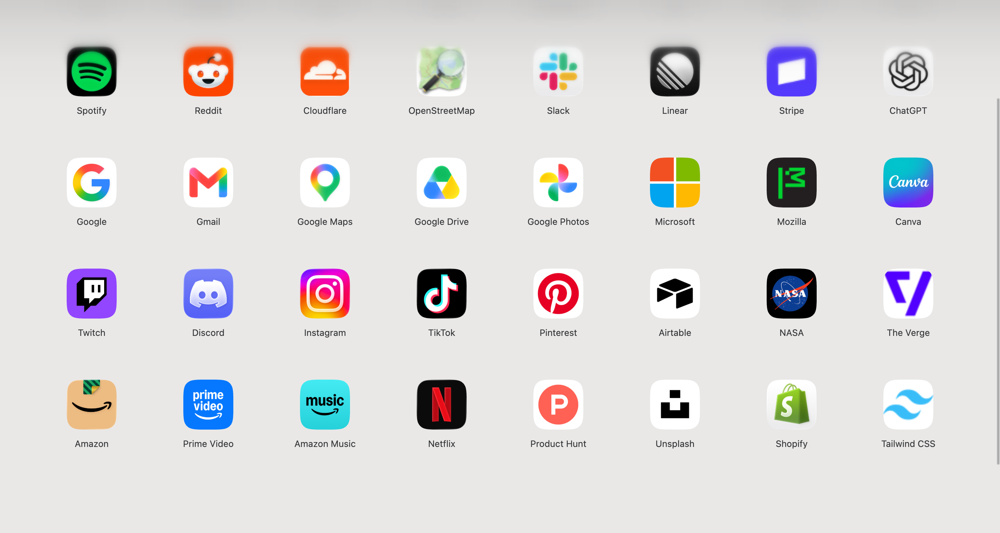
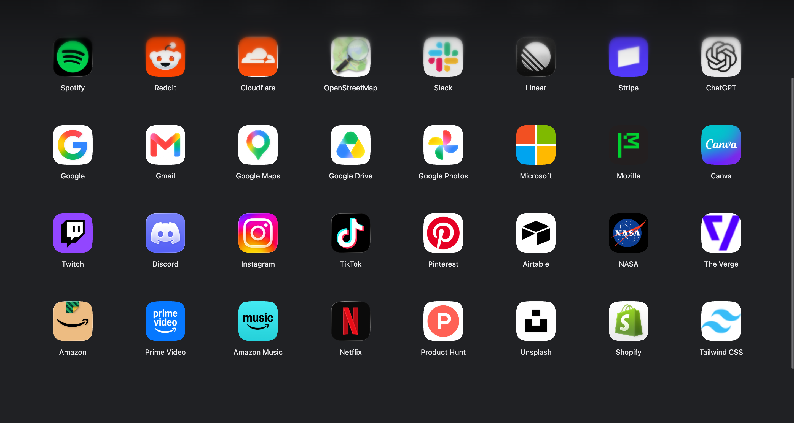

[中文](README.md) | [English](README.en.md)

# Yiu’s tab

简洁的 Chrome 新标签页扩展。通过浏览器书签管理网站，支持高清图标、拖动排序、外观调整与 WebDAV 同步。





## 功能

- 自适应书签网格、自动深浅主题、共享 UI 组件与动效。
- 优先从网站获取图标并在本地缓存；可选第三方来源、Apple App Store 匹配或本地图片。
- Option / Alt 点击网站图标调整外观；Option / Alt 点击空白区域打开扩展设置。首次安装的空白页面会显示对应设备的按键与鼠标图标指引。
- 完整配置导入、导出与可选 WebDAV 自动同步，包含书签、图标与外观设置。
- 新标签页显示同步状态、上次成功时间、冲突数量和手动同步入口；设置页提供连接测试与往返延迟。
- 中文、英语、日语、韩语界面，扩展元数据另含繁体中文。

## 安装

需要 Chrome 139 或更高版本（Manifest V3）。

1. 下载并解压源码或扩展安装包。
2. 打开 `chrome://extensions`，开启开发者模式。
3. 点击“加载已解压的扩展程序”，选择包含 `manifest.json` 的目录。
4. 打开新标签页，在书签管理器的“其他书签 → Yiu's tab”文件夹中添加网站。

文件夹可以移动或改名，请保留其中用于识别的 ID 书签。更新已加载的扩展时，覆盖原目录中的文件并点击扩展的重新加载按钮，避免因更换加载目录产生新的扩展 ID。

## 数据与同步

WebDAV 默认关闭，服务器地址和凭据默认为空。在扩展设置中填写服务商提供的服务器地址、账号及应用密码后启用。账号与应用密码仅按用户选择保存在本机，不写入配置备份或云端配置。

同步使用带稳定实体 ID 的变更记录和 ETag 条件写入。同一基线的不同字段会合并，同字段并发修改会保留双方副本到 `_sync-conflicts/` 并等待手动处理；删除使用保留至少 90 天的 tombstone。第三方图标接口只在选择对应来源时请求。网站与图片访问、权限和数据处理见 [PRIVACY.md](PRIVACY.md)。

## 代码结构

见 [ARCHITECTURE.md](ARCHITECTURE.md) 和 [UI_SPEC.md](UI_SPEC.md)。

生成扩展安装包：

```sh
python3 tools/package.py
```

构建结果位于 `dist/Yius-tab-1.0.zip`。无需安装 JavaScript 构建依赖。开发者可从 `_locales` 对应的生成脚本维护翻译。

## 来源与致谢

**本项目基于 [Bliphome](https://github.com/folletto/Bliphome)（Erin Casali）改造。** 保留了“以浏览器书签驱动简洁新标签页”的产品基础；当前页面、图标处理、共享 UI、设置及同步架构已大幅重写或扩展。它是 Bliphome 的衍生项目，并非原项目的官方版本。

通知使用本地打包的 [simple-liquid-glass](https://github.com/lucaperullo/simple-liquid-glass) 组件。第三方来源和许可证见 [THIRD_PARTY_NOTICES.md](THIRD_PARTY_NOTICES.md)。

本项目使用 [BSD-2-Clause](LICENSE) 许可证；第三方声明及许可证仍然适用。
